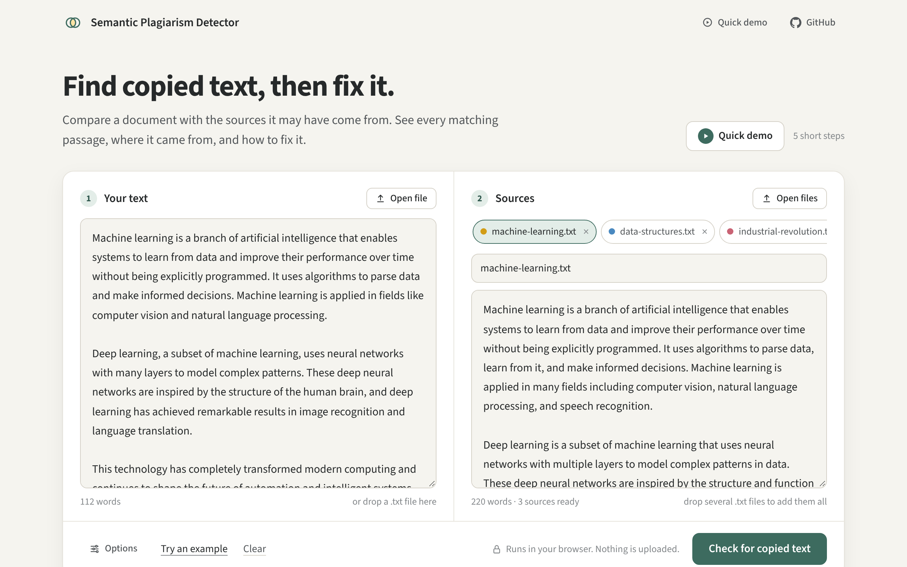
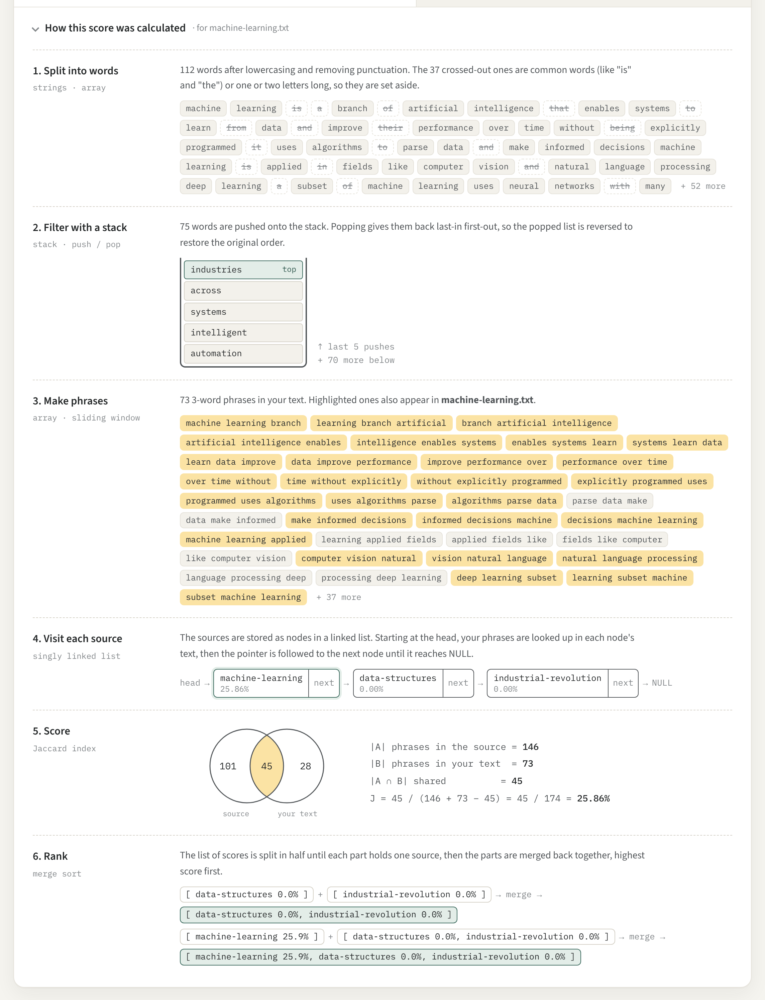

# Semantic Plagiarism Detector

Checks a piece of writing against the texts it might have been copied from. Both are cut into three-word phrases, the shared phrases are counted and scored, and every shared passage is highlighted.

### [Try it live: pranav-0712.github.io/semantic-plagiarism-detector](https://pranav-0712.github.io/semantic-plagiarism-detector/)

No installation or sign-up. Open the link and select **Quick demo** for a five-step walkthrough, or click **Try an example**, then **Check for copied text**.

[How it works](#how-it-works) · [Run the desktop engine](#desktop-engine-c) · [Project report](docs/report.md)

[](https://pranav-0712.github.io/semantic-plagiarism-detector/)

---

## Overview

Semantic Plagiarism Detector consists of two parts that share the same detection algorithm:

| Component | Description |
|---|---|
| **Web app** ([live site](https://pranav-0712.github.io/semantic-plagiarism-detector/), source: [`docs/index.html`](docs/index.html)) | A single-page application that runs entirely in the browser. No installation, no account, and no text is ever uploaded. Hosted on GitHub Pages. |
| **Desktop engine** ([`src/`](src)) | A dependency-free C++17 command-line application for managing a reference library and checking documents offline. |

## Features

- **Many sources, one check.** Compare a document against multiple sources at once. Results are ranked from most to least similar, and each source has its own highlight colour.
- **Passages to fix.** Every copied passage is listed next to the place it came from in the source, with one-click actions: **Show in text**, **Copy as quote** (adds the source) and **Mark as cited** (the score is recalculated straight away).
- **Where the matches are.** A strip shows where copied passages sit in your text. Click a mark to jump to it.
- **Quotations are skipped.** Text inside quotation marks is treated as already cited and left out of the score (can be turned off).
- **Clear advice.** The result says what to do next, with key figures: share of words found in a source, matching passages, sources compared and passages marked as cited.
- **How the score was calculated.** An optional panel shows what each data structure did with your text: the words the stack filtered out, the linked list of sources, the Jaccard calculation and each merge sort step.
- **Professional report.** Save the result as a PDF (score, sources, highlighted text and passages) or download it as plain text.
- **Quick demo.** A built-in, five-step guided walkthrough that runs a real check on example texts.
- **Your work is kept.** Text is saved in the browser, so a reload doesn't lose it.
- **Private by design.** All processing happens locally. Documents never leave the device.
- **Meaningful scores.** Common words such as "the" and "of" are ignored, so scores reflect shared content rather than shared grammar.
- **Adjustable precision.** Choose a phrase length of 2 to 5 words.
- **Downloadable reports.** Export a plain-text report with scores, verdicts and matched phrases.
- **File support.** Paste text, or upload and drag in `.txt` files.




## How it works

1. **Clean.** Text is lowercased, punctuation is removed, and common words and words of two letters or fewer are filtered out.
2. **Split.** The remaining words are broken into overlapping phrases (word n-grams, three words long by default).
3. **Match.** Every phrase in the document is looked up in each source.
4. **Score.** Each source receives a Jaccard similarity score, and sources are ranked from highest to lowest.

```
similarity = |A ∩ B| / |A ∪ B| = shared / (|A| + |B| − shared)
```

where `A` and `B` are the phrase sets of the source and the document.

| Score | Verdict | Meaning |
|---|---|---|
| 25% and above | High plagiarism | Large portions of the document match the source. |
| 10% to 25% | Moderate | Several passages match. Check the highlighted text. |
| Below 10% | Low similarity | A few shared phrases, typical for documents on the same subject. |
| 0% | Original | No shared phrases. |

Detection works on word sequences. It finds copied and lightly edited text, including reordered sentences and small word changes. Text rewritten entirely in different words scores lower.

## Data structures

The engine is built on core data structures, each implemented from scratch.

| Data structure | Where | Purpose |
|---|---|---|
| Singly linked list | `document_store.h/.cpp` | Stores the reference library. Documents can be added and removed at runtime. |
| Stack (generic, array-based) | `stack.h` | Filters common words from the token stream. |
| Arrays and strings | `string_matcher.h/.cpp` | Normalisation, tokenisation and n-gram generation. |
| Naive string matching | `string_matcher.cpp` | Finds each document phrase in the reference text. |
| Merge sort | `sorter.h/.cpp` | Ranks results by similarity, highest first. |
| Linear search | `sorter.cpp`, `document_store.cpp` | Looks up documents and results by ID. |

## Getting started

### Web app

Open the live site at **https://pranav-0712.github.io/semantic-plagiarism-detector/**, or open `docs/index.html` directly in any modern browser. No server or build step is needed. Select **Quick demo** for a guided walkthrough, or click **Try an example** to see a sample result.

The site is deployed with GitHub Pages from the `docs/` folder of the `main` branch. Every push to `main` updates it automatically.

### Desktop engine (C++)

Requires a C++17 compiler (g++ 10+, clang++ 12+ or MSVC 2019+).

```bash
git clone https://github.com/pranav-0712/semantic-plagiarism-detector.git
cd semantic-plagiarism-detector
make
./plagiarism_detector
```

Without `make`:

```bash
g++ -std=c++17 -O2 -Wall -o plagiarism_detector src/*.cpp
```

On Windows, run `plagiarism_detector.exe`.

The interactive menu lets you:

```
1. Load reference document from file
2. Add reference text (manual input)
3. List all reference documents
4. Remove a reference document
5. Check a text file for plagiarism
6. Check typed text for plagiarism
7. Run demo with sample documents
0. Exit
```

Sample documents for testing are in [`samples/`](samples).

### Single-file version

[`practical/plagiarism_demo.cpp`](practical/plagiarism_demo.cpp) contains the complete engine in one file, with sample documents built in. It runs a step-by-step demonstration on start-up (three test cases: copied, partly copied and original), then opens an interactive menu.

```bash
cd practical
g++ -std=c++17 -Wall plagiarism_demo.cpp -o plagiarism_demo
./plagiarism_demo
```

On Windows, run `.\plagiarism_demo.exe`.

## Project structure

```
semantic-plagiarism-detector/
├── docs/
│   ├── index.html              Web app (live on GitHub Pages)
│   ├── assets/                 Screenshots
│   └── report.md               Project report
├── practical/
│   └── plagiarism_demo.cpp     Single-file version with built-in demo
├── samples/                    Sample reference and suspect documents
├── src/
│   ├── main.cpp                Command-line interface
│   ├── plagiarism_detector.*   Detection engine
│   ├── document_store.*        Linked-list document library
│   ├── string_matcher.*        Text processing and matching
│   ├── sorter.*                Merge sort and linear search
│   └── stack.h                 Generic stack
└── Makefile
```

## Roadmap

- Hash-based or KMP matching for faster lookups on large libraries
- Synonym handling to detect paraphrased text
- PDF and DOCX import

## Author

**Pranav** · [github.com/pranav-0712](https://github.com/pranav-0712)
